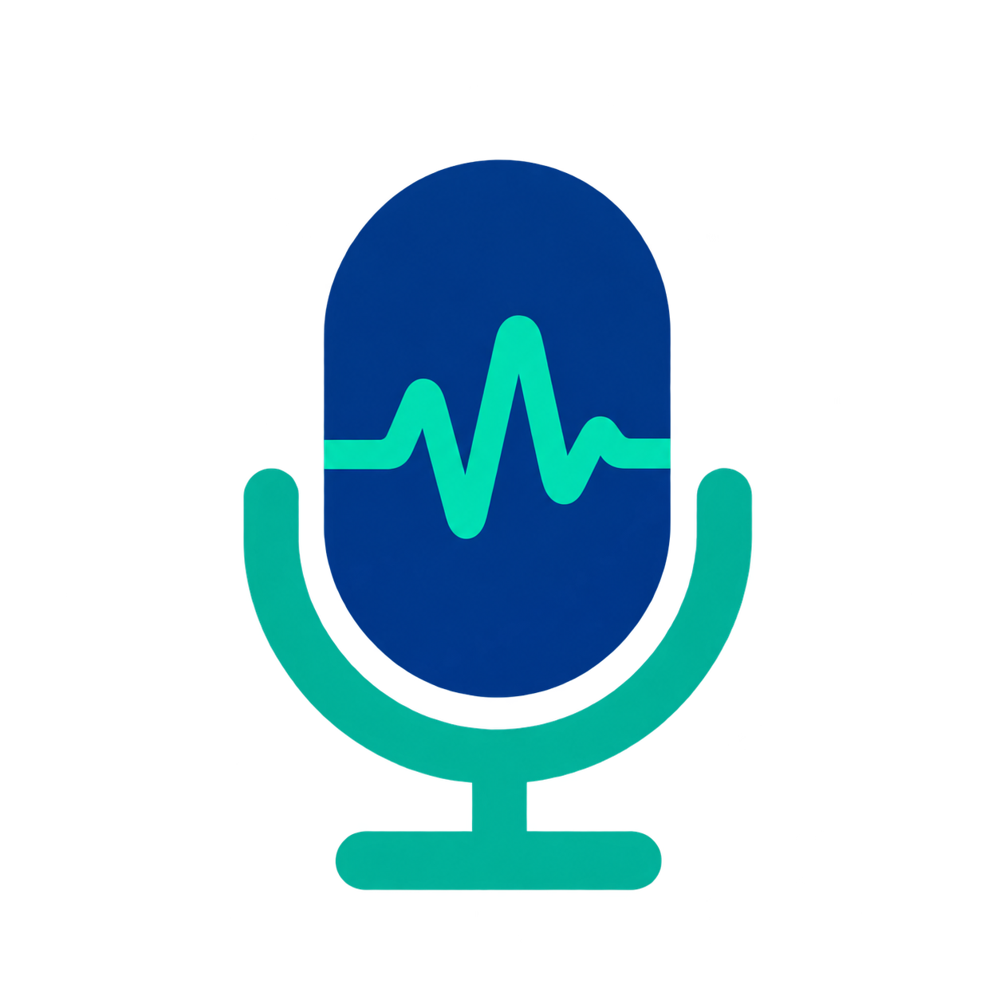

  

<h2 align="center">macos-mic-keepalive</h2>

  <strong>Keep your mic awake. Keep your coding flow.</strong> 
  Microphone keep-alive for voice-driven vibe coding on macOS.

  macOS 14+ · Native Swift · English / 中文 
  <a href="https://github.com/ababdotai/macos-mic-keepalive/releases/latest/download/Mic-KeepAlive-universal.dmg"><strong>Download for macOS</strong></a> ·
  <a href="#why">Why</a> · <a href="#how">How</a> · <a href="#what-you-get">What you get</a>

---

# Why

Vibe coding by voice? Your coding agent needs the start of your prompt, too.

With your MacBook closed and an external display connected, a Bluetooth mic may be your only practical input. After sitting idle, it can take seconds to wake—cutting off your first words. Keep it ready for your next instruction.

# How

Keeps an audio stream open on your chosen microphone. **No recordings. No uploads.**

**[Download the app](https://github.com/ababdotai/macos-mic-keepalive/releases/latest/download/Mic-KeepAlive-universal.dmg)** · macOS 14+ · Apple Silicon & Intel · No compilation needed.

Open the DMG, drag **Mic KeepAlive** into **Applications**, and launch it. Allow microphone access, then choose your mic and start keep-alive from the menu bar. Use the same mic in your dictation app.

Not Apple-notarized. If macOS blocks the first launch, use System Settings → Privacy & Security → Open Anyway for this trusted download. [Apple’s instructions](https://support.apple.com/en-us/102445). [ZIP alternative](https://github.com/ababdotai/macos-mic-keepalive/releases/latest/download/Mic-KeepAlive-universal.zip).

# What you get

- **Stay in flow:** reduce mic wake-up delays between spoken coding instructions.
- **Bluetooth-first:** use AirPods or a DJI Bluetooth mic. USB and other macOS inputs work too.
- **Live levels:** a small animated meter, no menu bar text.
- **Your language:** follows macOS—English or Chinese.
- **Your control:** stop anytime; disconnecting stops capture. No auto-start.

Bluetooth audio quality and battery life may be affected. Device results vary; DJI-specific behavior is not yet verified. This does not fix transcription or network delays.

Build from source (Xcode Command Line Tools): <code>make run</code> · Test: <code>make test</code> · Package: <code>make release</code>
