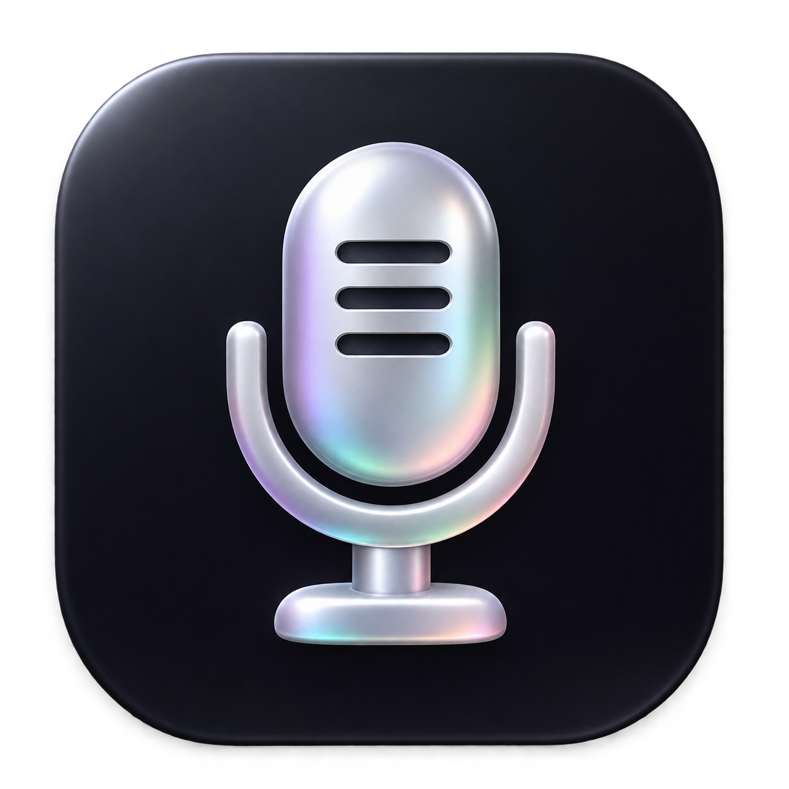

  

<h2 align="center">KeepMicAlive</h2>

  <strong>Keep your mic awake. Keep your coding flow.</strong> 
  Microphone keep-alive for voice-driven vibe coding on macOS.

  <strong>Support</strong> 
   
  Apple Silicon &amp; Intel · English / 中文 
  <a href="https://github.com/ababdotai/KeepMicAlive/releases/latest/download/KeepMicAlive-universal.dmg"><strong>Download for macOS</strong></a> ·
  <a href="#why">Why</a> · <a href="#how">How</a> · <a href="#what-you-get">What you get</a>

---

# Why

Vibe coding by voice? Your coding agent needs the start of your prompt, too.

With your MacBook closed and an external display connected, a Bluetooth mic may be your only practical input. After sitting idle, it can take seconds to wake—cutting off your first words. Keep it ready for your next instruction.

# How

Keeps an audio stream open on your chosen microphone. **No recordings. No uploads.**

**[Download the app](https://github.com/ababdotai/KeepMicAlive/releases/latest/download/KeepMicAlive-universal.dmg)** · macOS 14+ · Apple Silicon & Intel · No compilation needed.

Open the DMG, drag **KeepMicAlive** into **Applications**, and launch it. If upgrading from Mic KeepAlive, quit and remove the old app to avoid duplicates; settings use the same app identifier. Allow microphone access, then choose your mic and start keep-alive from the menu bar. Use the same mic in your dictation app.

**[1.5.1](https://github.com/ababdotai/KeepMicAlive/releases/tag/v1.5.1):** renamed to KeepMicAlive. Includes the native control panel, optional whisper boost, and AirPods / BlackHole routing fix.

Enable **Launch at login** and/or **Restore previous keep-alive on launch** in the menu if needed. Restore applies only when keep-alive was on at the previous exit. macOS may ask you to approve the login item.

Not Apple-notarized. If macOS blocks the first launch, use System Settings → Privacy & Security → Open Anyway for this trusted download. [Apple’s instructions](https://support.apple.com/en-us/102445). [ZIP alternative](https://github.com/ababdotai/KeepMicAlive/releases/latest/download/KeepMicAlive-universal.zip).

# What you get

- **Stay in flow:** reduce mic wake-up delays between spoken coding instructions.
- **Bluetooth-first:** use AirPods or a DJI Bluetooth mic. USB and other macOS inputs work too.
- **Frequent devices first:** remembers successful manual switches, with recent use breaking ties. Controls stay in an open panel; click outside to dismiss.
- **Readable status:** a plain mic means available; a shield means keep-alive is healthy; a plus above it means boost is running. The mic fills with the input level, an hourglass means recovery is pending, and a disconnect badge means the target mic is unavailable. No menu bar text. Turning keep-alive off also disables whisper boost, releases the mic and stops level monitoring.
- **Your language:** follows macOS—English or Chinese.
- **Automatic recovery:** sleep or disconnect pauses capture; wake or reconnect the same mic to resume. Stop cancels recovery.
- **Optional startup:** launch at login and restore previous keep-alive independently. Both default off.
- **System mic switching:** change the macOS input from the menu, even during keep-alive. Connected devices follow system changes; disconnected devices wait for reconnection.
- **Clear status:** separate system input and keep-alive device, plus live capture status. Apps pinned to a specific mic need their own input setting updated.

Bluetooth audio quality and battery life may be affected. Device results vary; DJI-specific behavior is not yet verified. This does not fix transcription or network delays.

Build from source (Xcode 26+ for icon compilation): <code>make run</code> · Test: <code>make test</code> · Package: <code>make release</code>

**Optional whisper boost:** install BlackHole 2ch using the panel’s official download link, enable boost, then select **BlackHole 2ch** in your dictation app. Boost enables keep-alive; stopping keep-alive turns both off. After stopping boost, switch dictation back to your physical mic. BlackHole is not bundled. No AI denoising; recognition gains are unproven. [Setup & comparison guide / 试用说明](docs/WHISPER-BOOST.md).
